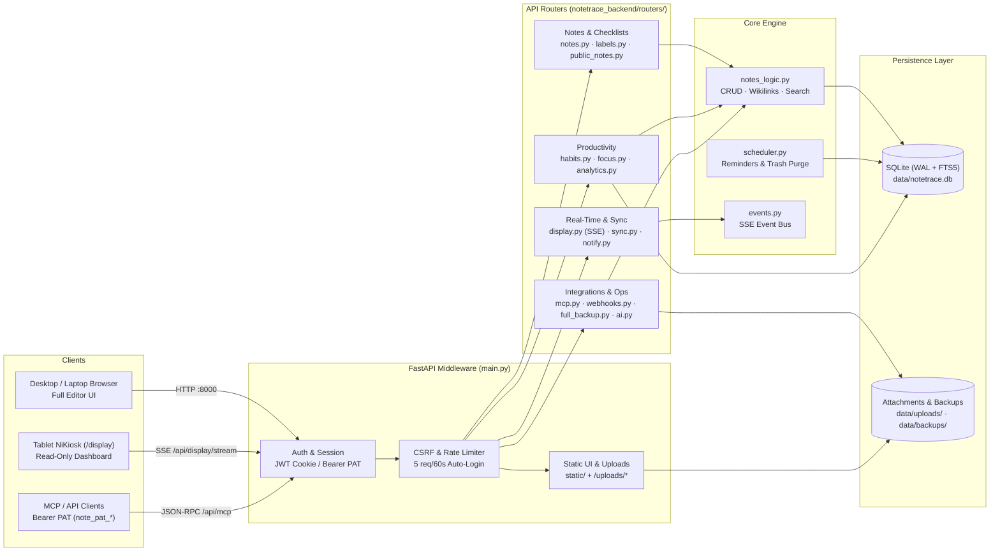

# Manifest

Self-hosted, local-first workspace for **notes, tasks, habits, focus timers, and analytics** — powered by **FastAPI + SQLite (WAL & FTS5)** with a pre-built static UI and zero Docker or Node.js runtime dependencies.

Runs on **Windows** and **Android/Termux** (with a real-time `/display` kiosk mode for **NiKiosk**).

---

## Technical Architecture



---

## Features

- **Notes & Checklists:** Markdown, drag-and-drop checklists, drawings, file/image uploads, PDF.js viewer, `[[Title]]` wikilinks, backlinks, and FTS5 full-text search.
- **Tasks & Reminders:** Due dates, recurring rules (`daily`, `weekly`, `monthly`, `yearly`, `weekdays`), and RRULE reminders.
- **Habits & Focus (`/api/habits`, `/api/focus`):** Custom habit tracking, streaks, and Pomodoro/focus sessions linked to notes or tasks.
- **Analytics (`/api/analytics`):** Task completion, focus time, and habit metrics.
- **Kiosk Mode (`/display`):** Live clock, pinned notes, due tasks, and instant SSE updates (`/api/display/stream`).
- **Auth, Sync & Integrations:** Multi-user bcrypt/JWT auth, shared note roles (`view`/`edit`), Personal Access Tokens (`note_pat_*`), `/api/mcp` JSON-RPC endpoint, webhooks, and ZIP backups.

---

## Quick Start

### Windows / Desktop
```powershell
python -m venv .venv
.venv\Scripts\Activate.ps1
pip install -r requirements.txt
python run.py
```
Access at `http://localhost:8000` (or the LAN IP printed in the console).

### Samsung Tablet (Termux + NiKiosk)
Install **Termux** and **Termux:Boot** from F-Droid, copy the project to `~/NoteTrace`, and run:
```bash
cd ~/NoteTrace && chmod +x termux/*.sh
./termux/install.sh
./termux/start.sh      # Stop anytime with ./termux/stop.sh
```
Point **NiKiosk** to `http://127.0.0.1:8000/display` and set Termux battery optimization to **Unrestricted**.

---

## Auto-Login Bookmarks

```text
http://<HOST_IP>:8000/?u=admin&p=YOUR_PASSWORD&redirect=/display
http://<HOST_IP>:8000/?token=note_pat_...&redirect=/display
```
Sets an `HttpOnly` session cookie and issues an immediate HTTP 303 redirect to strip credentials from browser history.

---

## Tests, Migrations & Packaging

```bash
python scripts/migrate.py                              # Initialize/verify SQLite + FTS5 schema
python -m unittest discover -s tests -p "test_*.py"    # Run test suite
python scripts/package_manifest.py                     # Build clean release ZIP
./termux/backup.sh                                     # Live SQLite + uploads snapshot (Termux)
```

---

## Environment Variables

| Variable | Default | Purpose |
|---|---|---|
| `HOST` / `PORT` | `0.0.0.0` / `8000` | Bind address and port |
| `DATA_DIR` | `./data` | Base dir for DB, uploads, and backups |
| `DB_PATH` | `./data/notetrace.db` | SQLite database path |
| `JWT_SECRET` | Auto / dev fallback | JWT signing secret |
| `SINGLE_USER_MODE` | `0` | `1` bypasses multi-user auth |
| `ALLOW_REGISTRATION` | `1` | Enable/disable user sign-ups |
| `TRASH_RETENTION_DAYS` | `30` | Days before trashed notes purge |
| `API_RATE_LIMIT_PER_MIN` | `60` | Per-minute API rate limit |
