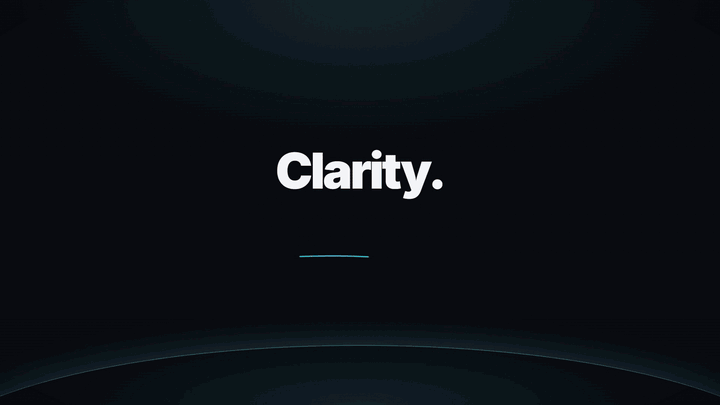
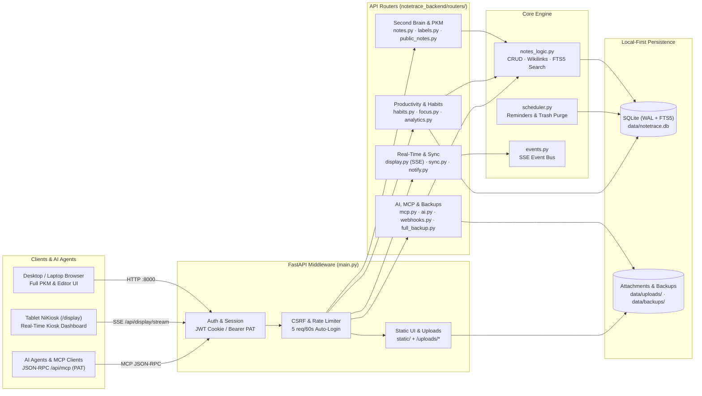

# Manifest — Local-First Second Brain, PKM & MCP Productivity Engine

A **self-hosted, local-first, privacy-first** Personal Knowledge Management (**PKM**) and productivity workspace built on **FastAPI** and zero-config **SQLite (WAL + FTS5)** with a built-in **Model Context Protocol (MCP) server** for AI agents — no Docker or Node.js runtime required.

Runs on **Windows**, **Linux**, and **Android / Termux** with a real-time `/display` **kiosk dashboard** for **NiKiosk**.

<p align="center">
  
</p>

---

## Technical Architecture



---

## Key Capabilities

- **Second Brain & PKM:** Markdown notes, `[[Title]]` wikilinks, backlinks, drag-and-drop checklists, drawings, PDF.js viewer, and instant **SQLite FTS5** full-text search.
- **Native MCP Server (`/api/mcp`):** JSON-RPC endpoint (`list_notes`, `get_note`, `create_note`) secured by Personal Access Tokens (`note_pat_*`) for connecting **AI coding assistants and agentic workflows**.
- **Tasks, Habits & Focus:** Recurring tasks (RRULE), custom **habit tracker** with streaks (`/api/habits`), **Pomodoro / focus timer** (`/api/focus`), and **productivity analytics** (`/api/analytics`).
- **Offline-First & Kiosk Ready (`/display`):** Single-file SQLite persistence, live Server-Sent Events (`/api/display/stream`), webhooks, multi-device sync, and ZIP backups.

---

## Quick Start

### Windows / Desktop
```powershell
python -m venv .venv
.venv\Scripts\Activate.ps1
pip install -r requirements.txt
python run.py
```
Open `http://localhost:8000` (or the LAN IP printed in the terminal).

### Android / Termux + NiKiosk
Install **Termux** and **Termux:Boot** from F-Droid, copy to `~/NoteTrace`, and run:
```bash
cd ~/NoteTrace && chmod +x termux/*.sh
./termux/install.sh
./termux/start.sh      # Stop anytime with ./termux/stop.sh
```
Set **NiKiosk** URL to `http://127.0.0.1:8000/display` and Termux battery to **Unrestricted**.

---

## Auto-Login Bookmarks

```text
http://<HOST_IP>:8000/?u=admin&p=YOUR_PASSWORD&redirect=/display
http://<HOST_IP>:8000/?token=note_pat_...&redirect=/display
```
Sets an `HttpOnly` cookie and issues an HTTP 303 redirect to strip credentials from browser history.

---

## Tests, Migrations & Packaging

```bash
python scripts/migrate.py                              # Initialize/verify SQLite + FTS5 schema
python -m unittest discover -s tests -p "test_*.py"    # Run test suite
python scripts/package_manifest.py                     # Build clean release ZIP
./termux/backup.sh                                     # Live SQLite + uploads snapshot (Termux)
```

---

## Environment Variables

| Variable | Default | Purpose |
|---|---|---|
| `HOST` / `PORT` | `0.0.0.0` / `8000` | Bind address and port |
| `DATA_DIR` | `./data` | Base dir for DB, uploads, and backups |
| `DB_PATH` | `./data/notetrace.db` | SQLite database path |
| `JWT_SECRET` | Auto / dev fallback | JWT signing secret |
| `SINGLE_USER_MODE` | `0` | `1` bypasses multi-user auth |
| `ALLOW_REGISTRATION` | `1` | Enable/disable user sign-ups |
| `TRASH_RETENTION_DAYS` | `30` | Days before trashed notes purge |
| `API_RATE_LIMIT_PER_MIN` | `60` | Per-minute API rate limit |
